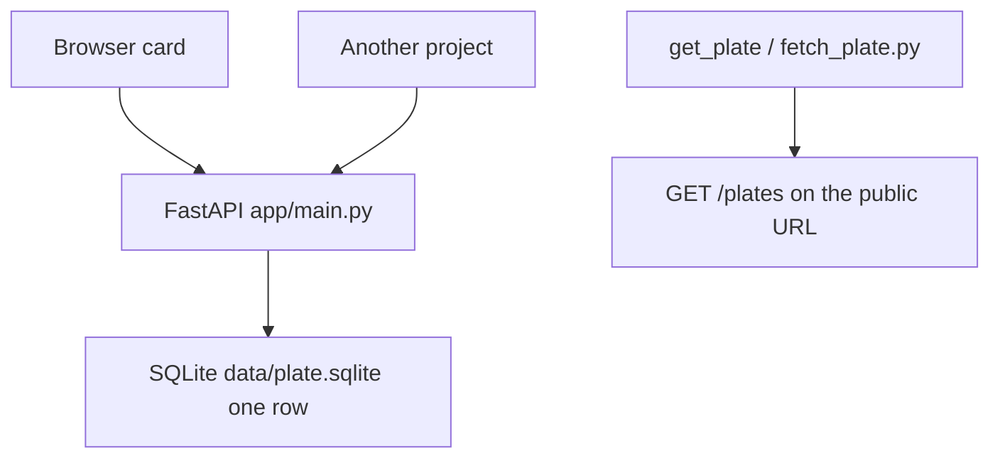
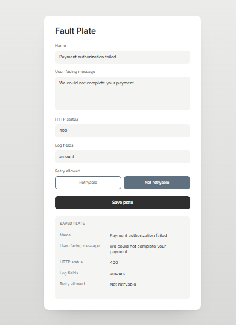
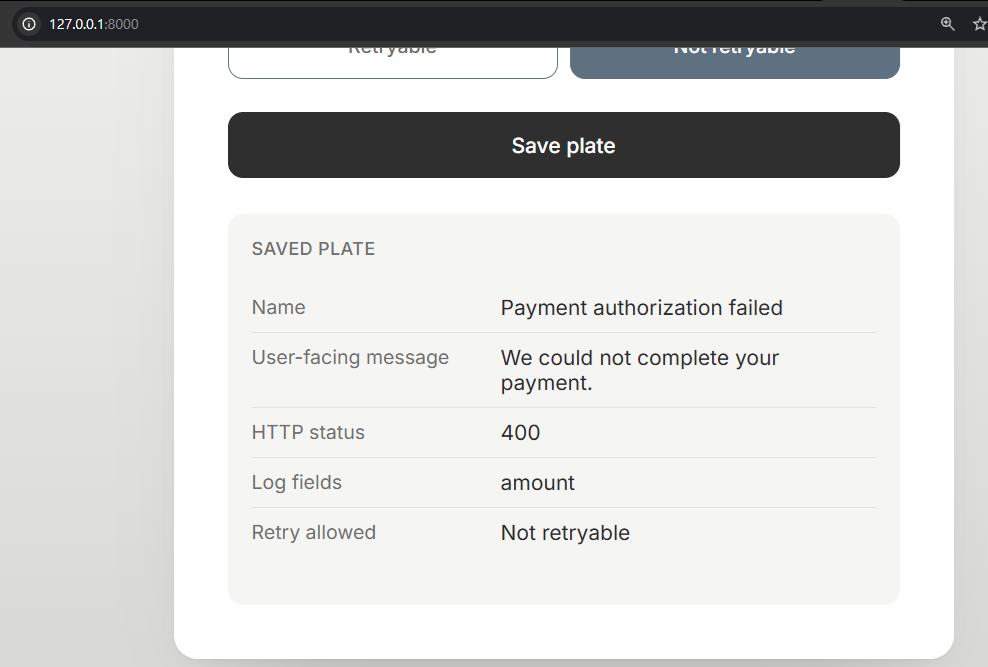
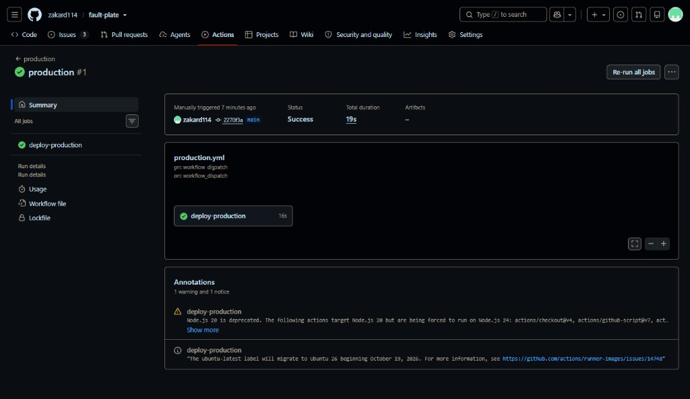
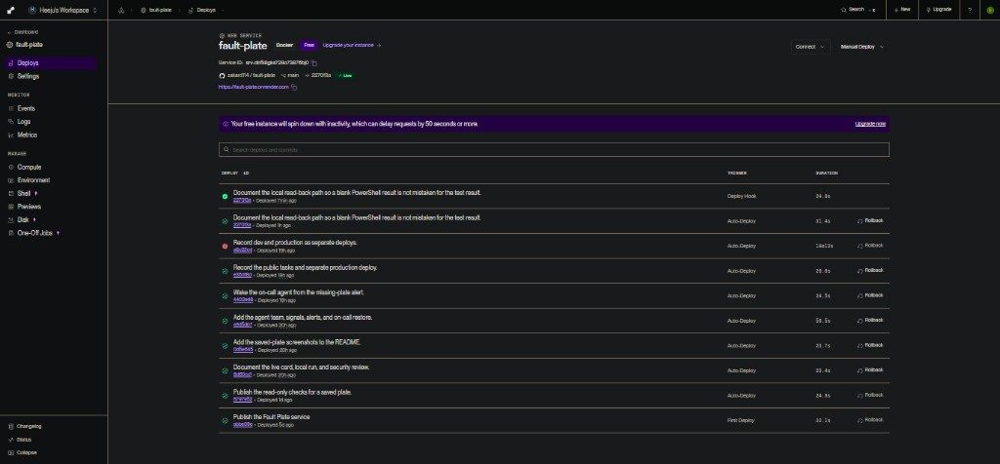

# Fault Plate

**One specification card for one API failure.** The sentence a caller reads and the record the server keeps are written once, on the same card.

**Live app:** https://fault-plate.onrender.com

Built as a final project for [AI Dev Tools Zoomcamp](https://github.com/DataTalksClub/ai-dev-tools-zoomcamp).

## Mission

When an API fails, the caller-facing sentence and the server record drift apart if they are written in different places. Fault Plate fixes those decisions on one card. Saving the card finishes that failure's specification.

This app does not detect a live payment failure and pull the card by itself. The project that takes the payment has to read the saved card. Without that read, the card stays in this store.

[↑ Contents](#table-of-contents)

## Table of contents

- [Mission](#mission)
- [Problem](#problem)
- [Status](#status)
- [Quick start](#quick-start)
- [Warnings](#warnings)
- [Architecture](#architecture)
- [Decisions and trade-offs](#decisions-and-trade-offs)
- [Project structure](#project-structure)
- [Screenshots](#screenshots)
- [What was built](#what-was-built)
- [Cloud deployment](#cloud-deployment)
- [Security review](#security-review)
- [Agent team](#agent-team)
- [CI/CD](#cicd)
- [Observability and alerts](#observability-and-alerts)
- [License](#license)

## Problem

An API failure has five decisions. Fault Plate stores them as one card:

| Field | Meaning |
|-------|---------|
| Name | Name of this failure |
| User-facing message | Sentence the API caller reads |
| HTTP status | Status value stored on the card, for example 400 |
| Log fields | Fields the server record should include |
| Retry allowed | `retryable` or `not_retryable` |

The screen is one card. Save stays on that screen. There is no list, dashboard, login, or second page.

The store keeps one card. A new save replaces the previous card. Several failure types would need more than one card and a lookup by name. This app does not do that lookup.

This is not a continuation of a course app. It does not read logs to find a root cause.

[↑ Contents](#table-of-contents)

## Status

The live service is https://fault-plate.onrender.com on Render's free instance.

Free instances sleep when idle, and the SQLite file on that instance can disappear after sleep or a new deploy. Local Docker keeps the card in `./data`, which is not committed.

[↑ Contents](#table-of-contents)

## Quick start

Commands assume the repository root after clone.

Create the virtual environment and install dependencies once:

```powershell
python -m venv venv
.\venv\Scripts\Activate.ps1
pip install -r requirements.txt
```

1. In PowerShell window A, from the repository root, start the server and leave that window open:

```powershell
uvicorn app.main:app --host 127.0.0.1 --port 8000
```

Wait until it says `Uvicorn running on http://127.0.0.1:8000`. A blue marker or a blinking cursor means that window is still running. Do not type the next command there.

2. In the browser at http://127.0.0.1:8000/ save the five fields. The same screen shows Saved plate. That is only the screen check.

3. In PowerShell window B, read the stored card:

```powershell
curl.exe -i http://127.0.0.1:8000/plates
```

Success is a line `HTTP/1.1 200` and a JSON body whose five fields match the Saved plate. The screen label Not retryable is the JSON value `not_retryable`. `curl.exe` without `-i` prints only the JSON body. That body alone also means the read succeeded, but `-i` is the command that shows 200.

4. `pytest` does not need the server. `6 passed` is success. It may sit on the line `collecting 0 items` before the count appears. The two `DeprecationWarning` lines about `on_event` are not failures.

```powershell
pytest
```

`tests/test_plates.py` checks that five valid fields return 201 and can be read back, and that a bad `retry_allowed` value returns 422.

Container:

```powershell
docker compose up --build
```

The compose file publishes port 8000 and mounts `./data` so the SQLite file survives a container restart.

[↑ Contents](#table-of-contents)

## Warnings

Do not use `Invoke-WebRequest` or `$r.StatusCode` / `$r.Content` for this check. On Windows PowerShell those members can print blank lines even after the assignment, so it looks like no data.

If that request sits with a blinking cursor and no output, the server is not answering. Press Ctrl+C. Start window A first.

`curl: (7) Failed to connect to 127.0.0.1 port 8000` means window A is not running. Start uvicorn, wait for `Uvicorn running`, then run `curl.exe -i` again in window B.

`pytest` is not where the 200 appears.

[↑ Contents](#table-of-contents)

## Architecture



The browser posts the five fields to `POST /plates`. The API stores one row and returns the same five fields. `GET /plates` returns that row, or 404 when the store is empty. A separate project, or the read-only `get_plate` tool, uses that GET. Nothing in this app watches a payment and opens the card on its own.

[↑ Contents](#table-of-contents)

## Decisions and trade-offs

- **One card, overwrite on save.** The product is one specification, not a catalog. Trade-off: a second failure type replaces the first.
- **HTTP status is a field, not the response code.** `POST /plates` returns 201 when the card is stored. The number on the card, such as 400, is the status the specified failure uses.
- **SQLite in the container, not a hosted database.** Local `./data` survives a restart. The free Render disk does not. Trade-off: the public card can vanish after sleep or redeploy.
- **No login.** Anyone who can reach the service can replace the one card. That limit is recorded in the security review. Login was left out on purpose.
- **Read-only agent tools.** `get_plate` and `fetch_plate.py` call `GET /plates` only. The hook checks that the five fields are present. They do not save, delete, or deploy.

[↑ Contents](#table-of-contents)

## Project structure

```text
app/main.py                         # POST /plates, GET /plates, GET /
app/index.html                      # the one card
openapi.yaml                        # the contract
tests/test_plates.py                # five fields, and a rejected retry value
Dockerfile                          # public image
docker-compose.yaml                 # local app plus ./data
agent-capabilities/permissions.md   # what the tools are allowed to do
agent-capabilities/hooks/check_plate.py
agent-capabilities/mcp/server.py    # get_plate
agent-capabilities/mcp/fetch_plate.py
```

[↑ Contents](#table-of-contents)

## Screenshots

Live card: https://fault-plate.onrender.com

The card has Name, User-facing message, HTTP status, Log fields, Retry allowed, and Save plate. After a save, Saved plate on the same screen shows the five stored values.



Local check at `127.0.0.1:8000`, after Save plate:



[↑ Contents](#table-of-contents)

## What was built

| Step | Evidence |
|------|----------|
| Problem | [Problem](#problem) |
| One screen | `app/index.html` |
| API contract | `openapi.yaml` `POST /plates` and `GET /plates` |
| Backend | `app/main.py` returns 201 with the same five fields |
| Persistence | one SQLite row; `GET /plates` reads it back |
| Tests | `pytest` — `tests/test_plates.py` |
| Container | `Dockerfile`, `docker-compose.yaml` |
| Deploy | https://fault-plate.onrender.com |
| Agent tools | `agent-capabilities/` — read and field check only |
| Security review | [Security review](#security-review) |

[↑ Contents](#table-of-contents)

## Cloud deployment

Render web service, Docker, branch `main`, free instance.

The image command listens on Render's `PORT`:

```text
uvicorn app.main:app --host 0.0.0.0 --port ${PORT:-8000}
```

No environment variables are required. Do not set a health check path. After a new deploy the public SQLite file can be empty, so `GET /plates` returns 404 until the card is saved again.

[↑ Contents](#table-of-contents)

## Security review

Reviewed on 2026-10-11. Details: [`docs/SECURITY.md`](docs/SECURITY.md).

- The public file list is the app, the contract, the tests, and the Docker files.
- A search for key, password, and private-key patterns in the project files found no secret. The only matching line was the search command itself, written in an untracked local note.
- `check_plate.py` only checks that the five fields exist.
- `get_plate` and `fetch_plate.py` only call `GET /plates`.
- `POST /plates` has no login, so a caller can replace the one stored card. This product does not add login.

[↑ Contents](#table-of-contents)

## Agent team

The roles and the handoff are in [`docs/team.md`](docs/team.md). The project instructions in [`AGENTS.md`](AGENTS.md) point at that file, [`docs/workflow.md`](docs/workflow.md), and [`docs/product-spec.md`](docs/product-spec.md).

The reviewer subagent only checks the five fields. When `GET /plates` returns 404, the alert `saved_plate_unavailable` opens and the on-call agent wakes on its own and writes the runbook card. `custom-agent/agent.py` is the same repair run by hand.

[↑ Contents](#table-of-contents)

## CI/CD

Pull requests run `pytest` only. A push to `main` runs `pytest`, then the `deploy-dev` job records a GitHub deployment with environment name `dev`. That record is the dev deploy. Render auto-deploy of `main` remains the dev host https://fault-plate.onrender.com. If `RENDER_DEPLOY_HOOK_URL` is set, that job POSTs the hook. If it is not set, the job still succeeds. Production never runs on push. A person must start `.github/workflows/production.yml` (`workflow_dispatch` only). That workflow runs `pytest`, then records a GitHub deployment with environment name `production`. If `RENDER_PRODUCTION_DEPLOY_HOOK_URL` is set, it POSTs that hook after the tests. If it is not set, the job still succeeds as the manual production deployment record. There is no second public URL. The tasks and acceptance criteria are in [`docs/tracker.md`](docs/tracker.md).

GitHub Actions run [production #1](https://github.com/zakard114/fault-plate/actions/runs/39019693551) was manually triggered on `main` at commit `2270f3a` and finished Success in 19s.



The Render deploys list shows that same commit twice. The later row trigger is Deploy Hook (Deployed, about 24s) and the earlier row of the same commit is Auto-Deploy. That Deploy Hook row is the manual production run updating https://fault-plate.onrender.com.



[↑ Contents](#table-of-contents)

## Observability and alerts

`GET /ops` is the signal UI. Each request gets a trace id, a structured log line, and a stored row with method, path, status, and duration. The card text is not in those signals.

`saved_plate_unavailable` opens when `GET /plates` returns 404. `plate_save_failed` opens when `POST /plates` returns 500 or higher. `GET /alerts` lists them.

[↑ Contents](#table-of-contents)

## License

MIT

[↑ Contents](#table-of-contents)
